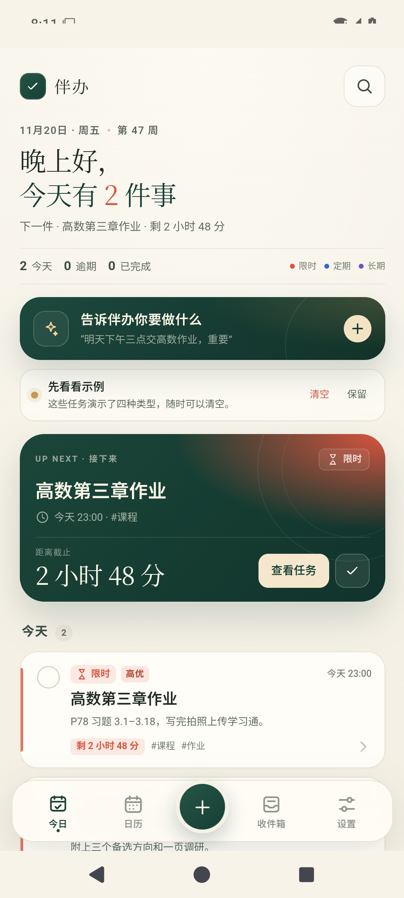
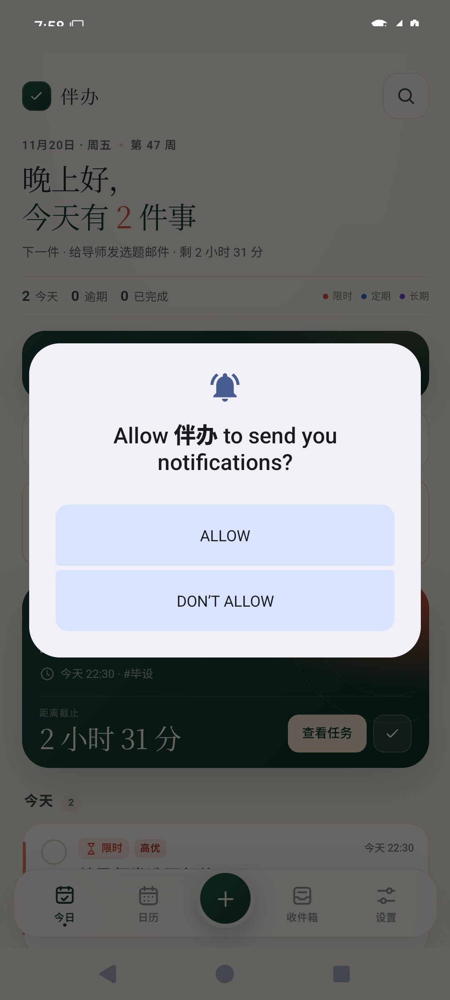
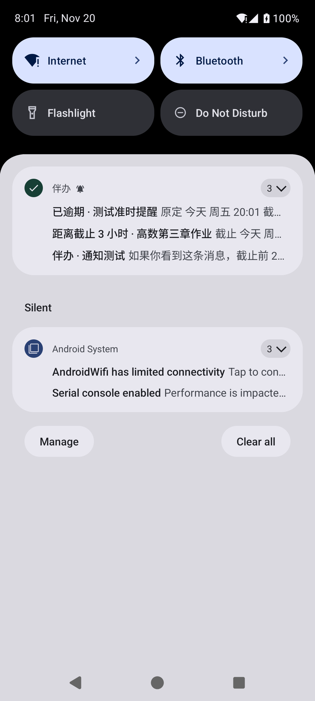
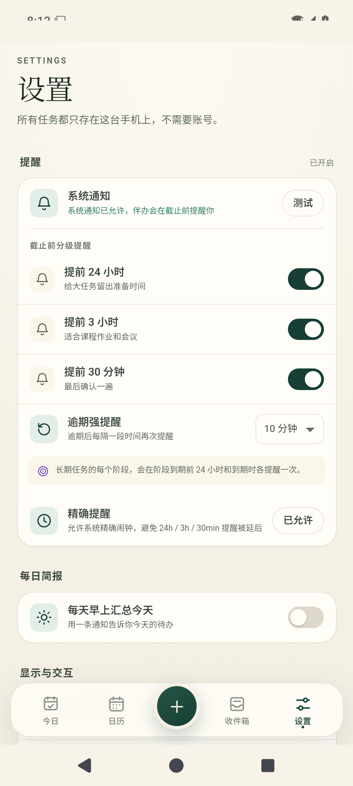

# 伴办 · Android 安装包 + iOS 工程

> 版本 **0.9.1** · Android 包名 `com.banban.app` · iOS Bundle ID `com.banban.app`  
> Android 7.0+ · iOS 15.0+ · 仅手机竖屏

Android 安装包已发布在 **[GitHub Releases](https://github.com/light-FY/daypal/releases)**（约 3.4MB）。

SHA-256：`6205D293D29D743FFEC71D3AB20F704D3583F6F5AA8FE6D6961A2F2DE295B6CA`

这是用 Capacitor 封装的原生应用：界面、数据、解析器与网页版完全一致，额外接入了 **系统本地通知**，不再依赖浏览器是否还开着。

> **关于 iOS `.ipa`**：iOS Xcode 工程已经生成并配置好，但当前机器是 Windows，没有 Xcode，也没有 Apple 签名证书，因此**无法在本机编译出可安装的 `.ipa`**。构建方法见 [iOS BUILD](ios/BUILD.md)。

## 产品文档

- [需求文档](docs/01-需求文档.md)
- [页面结构](docs/02-页面结构.md)
- [数据模型](docs/03-数据模型.md)
- [技术方案](docs/04-技术方案.md)
- [分阶段实现](docs/05-分阶段实现.md)

| 首页 | 通知权限 | 系统通知 |
| --- | --- | --- |
|  |  |  |

| 提醒设置 |
| --- |
|  |

---

## 1. 安装到手机

1. 把 `伴办-Android.apk` 传到手机（微信文件传输助手、USB、网盘均可）。
2. 在手机上点开 APK。
3. 系统提示“未知来源应用”时，允许当前文件管理器/浏览器安装。
4. 安装完成后，桌面出现「伴办」图标。

> APK 已使用 release 密钥签名，不是调试包。  
> Android 7.0 以下无法安装。

也可以连 USB 用 adb：

```bash
adb install 伴办-Android.apk
```

---

## 2. 第一次打开

1. 打开「伴办」→ 进入「设置 → 提醒」。
2. 点「系统通知 → 开启」，允许通知权限。
3. 点「测试」，应看到一条系统通知。
4. 如果「精确提醒」显示「去允许」，点它进入系统的“闹钟和提醒”设置，允许伴办使用精确闹钟。
5. 建议在系统设置里把伴办的后台电池策略设为「不限制」，避免国产 ROM 杀掉后台闹钟。

首次打开自带 8 条示例任务，可在设置里清空。

---

## 3. Android 版新增能力

| 能力 | 说明 |
| --- | --- |
| 无开屏动画 | 0.9.1 移除了自定义启动图；启动为纯米色，无图标、无缩放动画 |
| 原生本地通知 | 截止前 24h / 3h / 30min，由系统闹钟排程 |
| 逾期强提醒 | 逾期后每 5/10/30/60 分钟重复，最多排 8 次；持续更久需打开 App 后重排 |
| 长期阶段提醒 | 阶段前 24h + 阶段到期时 |
| 点击通知 | 打开对应任务详情（测试通知打开设置页） |
| 精确闹钟 | 设置页可跳转系统“闹钟和提醒”权限 |
| 开机恢复 | 插件注册了 BOOT_COMPLETED 接收器，重启后会尝试恢复通知 |
| 导出备份 | 生成 JSON 后调起 Android 分享面板，可保存到文件/网盘/发送 |
| 返回键 | 优先关闭弹层 → 返回上一页 → 退出 App |
| 离线 | 所有 Web 资源打包在 APK 内，无需联网 |

---

## 4. 技术结构

```
banban-mobile/
├── native-src.js             原生通知/分享/返回键桥接源码
├── www/                      打包进 APK 的 Web 应用（伴办）
│   └── js/native.js          esbuild 打包后的桥接
├── android/                  Capacitor Android 工程
│   ├── app/src/main/...      图标、启动图、通知声音、Manifest
│   ├── keystore/             发布签名（不要公开）
│   └── keystore.properties   签名配置
├── tools/
│   ├── make_android_assets.py  图标/启动图生成
│   └── make_sounds.py          通知提示音生成
└── package.json
```

依赖：

- Capacitor 8.6.2
- `@capacitor/local-notifications` 8.3.1
- `@capacitor/app` 8.1.2
- `@capacitor/filesystem` 8.1.5
- `@capacitor/share` 8.0.3

---

## 5. 重新构建

环境：

- JDK 21
- Android SDK Platform 36、Build-Tools 36.0.0
- Node.js 20+
- Gradle 8.14.3（wrapper 会自动下载；国内已改为腾讯镜像）

```powershell
$env:JAVA_HOME='C:\Program Files\Java\jdk-21.0.12.1'
$env:ANDROID_HOME='D:\Android\sdk'
$env:ANDROID_SDK_ROOT='D:\Android\sdk'
$env:Path="$env:JAVA_HOME\bin;$env:ANDROID_HOME\platform-tools;$env:Path"

cd D:\Deepseek Work\banban-mobile
npm install
npx cap sync android
cd android
.\gradlew.bat assembleRelease
```

产物：

```
android/app/build/outputs/apk/release/app-release.apk
```

如果改动了 `native-src.js`，先重新打包桥接：

```bash
npx esbuild native-src.js --bundle --format=iife --target=es2020 --minify --outfile=www/js/native.js
npx cap sync android
```

### 签名

本仓库**不包含** keystore、密码或任何签名密钥。正式 release 构建时，用自己的 keystore 通过环境变量传入：

```powershell
$env:BANBAN_KEYSTORE='C:\path\to\your-release.jks'
$env:BANBAN_KEYSTORE_PASSWORD='your-password'
$env:BANBAN_KEY_ALIAS='your-alias'
$env:BANBAN_KEY_PASSWORD='your-key-password'
cd android
.\gradlew.bat assembleRelease
```

没有设置这些变量时，`assembleRelease` 会生成未签名包，不会把密钥写进源码。

> 后续升级必须使用同一个 keystore 签名，否则不能覆盖安装。请不要把 keystore、密码或 `android/keystore.properties` 上传到 GitHub。

---

## 6. iOS 工程

`ios/` 目录是完整的 Capacitor iOS 工程，已配置：

- App 名「伴办」、Bundle ID `com.banban.app`、版本 0.9.1
- 仅 iPhone、仅竖屏、iOS 15+
- 1024×1024 不透明 AppIcon
- 无开屏动画：LaunchScreen 为纯米色
- 本地通知 / 分享 / 文件系统 / App 插件
- SPM 依赖已写入 `ios/App/CapApp-SPM/Package.swift`

要产出可安装的 `.ipa`，需要 **macOS + Xcode + Apple 签名**：

- 详细步骤：[ios/BUILD.md](ios/BUILD.md)
- 本地未签名 IPA 脚本：[ios/build-unsigned-ipa.sh](ios/build-unsigned-ipa.sh)
- GitHub Actions 未签名构建模板：[docs/ios-unsigned-workflow.yml](docs/ios-unsigned-workflow.yml)

> Windows 上无法编译或签名 iOS 应用；在没有 Mac / macOS CI 的情况下，不能提供真正可安装的 `.ipa`。

---

## 7. 已在模拟器验证

Android 15（API 35）x86_64，官方 emulator：

- [x] APK 安装、启动、桌面图标、启动页
- [x] 首次通知权限弹窗与「开启」流程
- [x] 系统通知测试
- [x] 90 秒后的限时任务准时弹出「已逾期」通知
- [x] 通知分组、通知渠道、自定义提示音
- [x] 设置页「精确提醒」状态与系统权限联动
- [x] 导出备份时调起分享面板
- [x] 返回键、WebView 离线资源
- [x] release 签名 APK 可正常安装

---

## 8. 已知限制

- 不同厂商的省电策略差异很大（小米、华为、OPPO、vivo 等），可能延迟或拦截后台闹钟；请把伴办加入“不受限制/允许后台运行”。
- Android 12+ 的精确闹钟需要用户手动允许；未允许时会退化为非精确闹钟，可能延迟几分钟。
- 逾期重复提醒目前排 8 次；超过后需要打开一次 App 重新排程。
- 卸载 App 会清除本地任务数据，请先在设置里导出备份。
- iOS 安装包需要 Mac + Xcode 签名，本次未包含；需要 iOS 时可在 macOS 上复用 `www/` 和 `native-src.js` 重新封装。
- 本安装包面向个人/课程使用，未上架 Google Play；上架前需要补隐私政策、目标 API 合规和精确闹钟权限说明。
